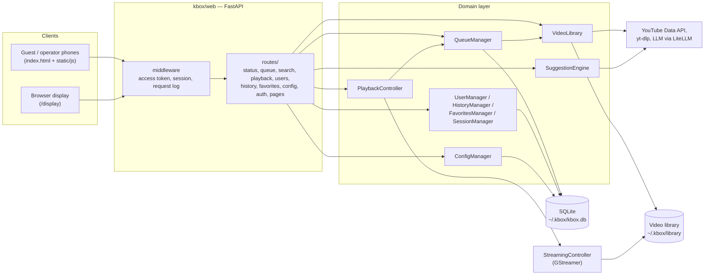

# kbox Architecture

How the pieces of kbox fit together: what each module owns, how a song gets
from a guest's phone onto the screen, and where state lives. This is the map;
the deep dives are linked from the sections they belong to.

kbox is a single Python process. It serves a mobile web UI to guests, keeps a
persistent song queue, fetches karaoke videos, and plays them through a
GStreamer pipeline (or, as an alternative, a browser display page). There is no
separate worker or message broker: background work runs on a few threads inside
the same process.

## The big picture

`kbox/main.py` is the composition root. `KboxServer.__init__` constructs every
component once, in dependency order, and passes collaborators in explicitly;
nothing reaches for a global. Reading that file top to bottom is the quickest
way to see what depends on what.

## Layers

### Web (`kbox/web/`)

A FastAPI app assembled by `create_app()` in `web/app.py`.

- **Routes** (`web/routes/`): one router per area: `status`, `queue`,
  `search`, `playback`, `users`, `history`, `favorites`, `config`, `auth`,
  and `pages` (the guest page, `/display`, icons). `status` holds
  `GET /api/status`, which every open page polls for what playback is
  doing, the queue, who is up next, the viewer's own next turn and the
  alerts addressed to them. Handlers are thin. They get their collaborators
  from `web/dependencies.py`, which reads them off `app.state`, and call
  into the domain layer.
- **Middleware** (`web/middleware.py`): `GuestAuthMiddleware` admits a guest
  who presents the access token (the `?key=` in the QR code) and stores the
  fact in a signed session cookie; `/display` and its API are exempt. The
  middleware order matters and is documented in `create_app()`.
- **Operator controls** are gated per handler by a PIN, separate from guest
  access. Controls are locked by default.
- **Front end**: server-rendered Jinja templates (`web/templates/`) plus
  plain ES modules (`web/static/js/`), with no build step. Static files are
  mounted under a per-process version path so browsers can cache them forever
  and still pick up a new deploy.

### Domain (`kbox/`)

| Module | Owns |
|---|---|
| `queue.py` `QueueManager` | The queue: add, remove, reorder, replace; content status per item; the background thread that prepares content for pending items |
| `playback/` `PlaybackController` | What is playing right now, the state machine, navigation (skip, previous, jump), transitions, history recording, error handling |
| `video_library.py` `VideoLibrary` | Search and metadata through pluggable sources, and a disk cache of downloaded videos with size-based eviction |
| `youtube.py`, `ytdlp.py`, `video_source.py` | The YouTube Data API client, the yt-dlp client (search fallback and downloads), and the source that composes them |
| `song_metadata.py`, `llm.py`, `suggestions.py` | LLM-backed artist/song extraction from video titles, and per-guest song suggestions, both through LiteLLM |
| `loudness.py`, `silence_detection.py` | Per-video analysis (ffmpeg): a normalization gain, and a trailing-silence trim point |
| `search_suggest.py` | Search-box autocomplete (see [search-autocomplete.md](search-autocomplete.md)) |
| `user.py`, `identity.py`, `history.py`, `favorites.py`, `session.py` | Guests, name-keyed identity, performance history, favorites, party sessions (see [guest-identity.md](guest-identity.md)) |
| `config_manager.py` | Typed settings with defaults and a schema that drives the settings UI |
| `interstitials.py`, `overlay.py` | Between-song screens and QR/overlay text |

### Persistence (`kbox/database/`)

SQLite, accessed through repository classes (`QueueRepository`,
`HistoryRepository`, `UserRepository`, `ConfigRepository`, `FavoriteRepository`,
`SessionRepository`, `EventRepository`). `database/schema.py` owns the
connection, table creation and migrations; all SQL lives in the repositories,
and the managers above speak in the dataclasses from `models.py`.

Tables: `users`, `config`, `queue_items`, `playback_history`,
`song_metadata_cache`, `user_events`, `favorites`, `sessions`, plus
`schema_version`. Beyond the obvious, the database also holds:

- **The queue cursor** (which song is current) in the `config` table, so a
  restart mid-party resumes in the right place.
- **Analysis caches** (extracted metadata, and loudness and silence results)
  so a video is analysed once.
- **Generated secrets**: the guest access token and the session-cookie secret,
  created on first run and kept across restarts.

Videos are not in the database; they are files in the library directory
(`~/.kbox/library` by default, `cache_directory` to change it).

### Streaming (`kbox/streaming/`)

`StreamingController` is the facade the rest of kbox sees: load a file,
play/pause/seek, set pitch and volume gain, set overlay text, show a still
image, and a callback for end-of-stream. Behind it are collaborators that own
the pipelines and overlays. The pipeline design, and the long list of things
that look right but are not, are in
[gstreamer-pipeline.md](gstreamer-pipeline.md); read that before touching this
package. `platform.py` isolates the macOS/Linux differences (sinks, the macOS
main-loop requirement).

## Life of a song

1. **Search.** A guest types a query. `GET /api/search` goes to
   `VideoLibrary.search()`, which asks the YouTube source (Data API when a key
   is configured, yt-dlp otherwise). Results are re-ranked toward karaoke
   channels. Suggestions as you type use `search_suggest.py` instead.
2. **Add.** `POST /api/queue` calls `QueueManager.add_song()`: the item is
   written with content status `pending`, attached to the current party
   session and the guest's identity.
3. **Prepare.** A background thread in `QueueManager` polls every couple of
   seconds. For each `pending` item it marks the item `preparing` and asks
   `VideoLibrary.request()` to download it (one download at a time). On
   completion the status becomes `ready` with a file path, then the
   post-download analyses run: metadata extraction, trailing-silence
   detection, loudness measurement. Each is optional and a failure in one is
   logged and skipped. Items stuck in `preparing` past a timeout are reset to
   `pending`. Finishing a download also triggers cache eviction, never
   touching videos that are still in the queue.
4. **Play.** `PlaybackController` picks the next ready song after its cursor
   and calls `_play_song()`: set the song's pitch, set the loudness gain,
   `load_file()` on the streaming controller, move the cursor, enter `PLAYING`.
5. **While playing.** A monitor thread ticks every couple of seconds and, under
   the playback lock, shows the "now singing" and "up next" overlays, advances
   early at the trailing-silence trim point, and auto-starts when idle and a
   song becomes ready.
6. **End.** GStreamer end-of-stream calls `on_song_end()`. The controller
   records the performance in history (if it ran long enough to count), shows
   a transition screen with the next singer, then starts the next song or shows
   the idle screen when the queue is exhausted.

Playback states: `STOPPED` (initial, or operator stopped; never auto-starts),
`IDLE` (queue exhausted; auto-starts when a song is added), `PLAYING`,
`PAUSED`, `TRANSITION` (interstitial between songs) and `ERROR`.

### Error handling

- A download that fails marks the item `error` with a message; it does not
  block the rest of the queue.
- A song that cannot be loaded puts playback into `STOPPED` with the idle
  screen showing, so the operator can investigate rather than the system
  skipping silently through the queue.
- Analyses are advisory: a song that has not been analysed plays at its native
  level to its literal end.
- Interstitial generation failure is never fatal; it logs and moves on.
- State survives a restart: the queue and cursor are in SQLite, and downloads
  still in flight are picked up again by the content monitor.

## Concurrency

The process mixes an async web server, a few daemon threads, and GStreamer's
own threads.

- **Request handlers** run in uvicorn (FastAPI), and the synchronous domain
  calls they make run on its threadpool.
- **Playback lock.** `PlaybackController` has one lock. Every public
  operation and every monitor tick takes it, so an operator's skip lands
  entirely before or after a tick, never in the middle. Its collaborators
  (cursor, overlays, screens) have no locks of their own and rely on this one.
- **Background threads:** the playback monitor, the content monitor in
  `QueueManager` (both `PeriodicThread`s from `periodic.py`), a
  single-worker download executor in `VideoLibrary`, and the GStreamer bus
  watcher. Analysis passes lower their scheduling priority (`priority.py`) so
  they don't starve playback.
- **macOS** needs the main thread for the GStreamer/AppKit run loop, so
  uvicorn runs in a thread there (`platform.py`).

## Two ways to show the screen

- **GStreamer pipeline (primary).** Songs are downloaded and decoded locally,
  and the video goes straight to the display (`kmssink` on the Pi) with kbox's
  own overlays, pitch shifting and volume control.
- **Browser display page (`/display`).** A fullscreen page that polls the
  queue (`/api/status`), plays each song in an embedded YouTube
  player, and posts to `/api/display/song-ended` when one finishes. When GStreamer isn't available,
  kbox starts without a download provider and uses this path.

Either way the guest and operator experience is the same: they use the phone
UI, and the queue and history live in the same database.

## Configuration

Settings are stored in the `config` table and read through `ConfigManager`,
which provides defaults, type conversion and a schema (labels, descriptions,
groups) that drives the settings UI. Settings are changed from the web UI,
and the controller rebuilds the pipeline when one that affects it changes
(`apply_streaming_config`). A few startup values come from the environment
instead, such as `KBOX_EXTERNAL_URL` for the address in the QR code.

## Where to look next

| Topic | Document |
|---|---|
| Pipeline design and pitfalls | [gstreamer-pipeline.md](gstreamer-pipeline.md) |
| Guest identity (product, then implementation) | [guest-identity.md](guest-identity.md), [guest-identity-implementation.md](guest-identity-implementation.md) |
| Search autocomplete | [search-autocomplete.md](search-autocomplete.md) |
| Why the product behaves as it does | [karaoke-party-reference.md](karaoke-party-reference.md) |
| Hardware and signal flow | [../hardware/hardware-setup.md](../hardware/hardware-setup.md) |
| Dev setup and releasing | [macos-setup.md](macos-setup.md), [releasing.md](releasing.md) |
