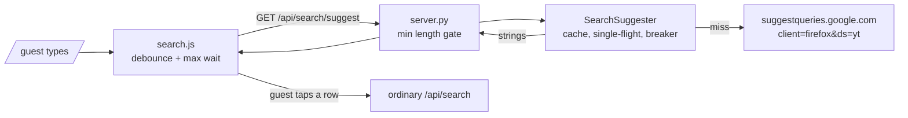

# Search Autocomplete

How the search box suggests completions, where its numbers came from, and what
is still unverified.

Read this before changing `kbox/search_suggest.py`, the suggestion handling in
`kbox/web/static/js/search.js`, or the `karaoke` normalization in
`kbox/video_library.py`. Most of the constants below look arbitrary and are
not; the ones that genuinely are judgement calls say so.

## The shape of it



Suggestions are **query strings, not videos**. Choosing one fills the search
box and runs a normal search; it does not add anything to the queue, and it
does not tell us a karaoke track exists. The feature buys keystrokes and
better-formed queries, nothing more.

## Why not the YouTube Data API

It cannot do this, for two independent reasons.

There is no suggestion endpoint in the Data API at all — the resource list has
exactly one search-related method, `search.list`, which returns full video
records.

And `search.list` is capped at **100 calls per day** by default. That is its
own quota bucket at 1 unit per call, separate from the 10,000-unit pool that
every other endpoint draws on, so raising "Queries per day" does not buy more
searches. A single party can exhaust 100 ordinary searches; a search per
keystroke would exhaust it during the first guest's first song. Even with a
raised quota it would be the wrong tool — ten video records with thumbnails
and durations, several hundred milliseconds, to render a list of plain text.

See [docs/setup/youtube-api.md](../setup/youtube-api.md) for the quota detail.

## Why Google's undocumented endpoint

`suggestqueries.google.com/complete/search?client=firefox&ds=yt` is what
YouTube's own search box uses. It is uncounted, it answered in ~65ms across 40
sequential requests with no sign of throttling, and its results are already
biased towards karaoke: completions for `bohemian rha` include
`bohemian rhapsody karaoke`, because that is what people actually search
YouTube for.

`client=firefox` returns a plain JSON array. `client=youtube` returns the same
data wrapped in a JSONP callback that would need stripping.

It is undocumented, unsupported, and carries no stability promise. **Therefore
everything fails quiet**: any error, timeout, malformed response, or operator
switching the feature off produces an empty list, which leaves the search box
behaving exactly as it did before autocomplete existed. Autocomplete is a
convenience, never a dependency. Nothing in this feature may ever surface an
error to a guest.

Requests are proxied through the server, not made from the browser: the
endpoint sends no CORS headers, and proxying keeps guests' partial queries off
their own connections.

## The numbers

### Minimum query length: 4 characters

Measured by replaying queries against the live endpoint at every prefix
length, asking whether the song the guest was heading for was already on offer
after kbox's own dedupe.

**Read the second row, not the first.** The first is what you get from a
corpus of 30 karaoke standards — the most-searched songs on earth, which is
exactly what a popularity-ranked suggestion endpoint is best at. The second is
185 real searches pulled from `user_events` on the production Pi.

| prefix length | 1 | 2 | 3 | 4 | 5 | 6 | 8 | 11 |
|---|---|---|---|---|---|---|---|---|
| 30 standards | 3% | 17% | 75% | 83% | 89% | 85% | 89% | 94% |
| **185 real queries** | **2%** | **2%** | **15%** | **29%** | **44%** | **52%** | **62%** | **83%** |

The sharp knee at three characters was an artifact of corpus selection, and
the original version of this document asserted it as fact. On real queries
there is no knee at all — it is a gradual ramp that does not pass half until
six characters, and plateaus around 80% rather than 90%.

So this threshold is a **judgement about where a dropdown stops being noise,
not a measurement**. Four is roughly where the hit rate doubles off the floor,
while still serving the genuine four-character queries in the corpus ("Mary",
"cure", "River", "Dream"), which a higher threshold would shut out entirely.
Raising it to six would be defensible on the curve alone; it would also mean
the shortest queries never get help.

Two things that do survive the real data:

- When a suggestion does land, it saves **9.1 characters of typing on
  average** (9.5 on the standards). The payoff is real, it just arrives later
  in the word than the synthetic corpus implied.
- **18% of real queries are never offered at any prefix length.** Obscure and
  independent material simply isn't in YouTube's suggestion index. For roughly
  one guest in five the dropdown never helps, and that is not a bug to fix.

Why real queries behave so differently: they are artist-plus-title
("<artist> <song>"), partial titles, frequently misspelled, sometimes
non-English, and often obscure. Median 15 characters, 3 words. **Do not
re-tune this against a corpus of well-known songs.**

The server enforces the gate (`MIN_SUGGEST_QUERY_LENGTH`) and the client
mirrors it (`SUGGEST_MIN_CHARS`), so a stale page cannot bypass it.

### Debounce 350ms, maximum wait 600ms

A debounce on its own is a **cliff, not a dial**. It fires on every keystroke
when the gap between keys is longer than the debounce, and not once until
typing stops when the gap is shorter. Typing `bohemian rhapsody` at fixed
cadences with a 350ms debounce and no cap:

| per-key | requests | first dropdown |
|---|---|---|
| 120ms | 1 | 2.3s |
| 250ms | 1 | 4.4s |
| 350ms | 15 | 1.1s |

Phone thumb-typing falls at 200–350ms between keys, straddling that edge. Two
guests typing at slightly different speeds would get entirely different
behavior, and the faster one would see nothing until after they had finished
typing — which is no feature at all.

A maximum wait decouples responsiveness from typing speed: if the guest is
still typing and it has been 600ms since the last list, refresh regardless of
the debounce.

| per-key | requests | first dropdown |
|---|---|---|
| 120ms | 4 | 255ms |
| 200ms | 6 | 416ms |
| 250ms | 6 | 520ms |
| 350ms | 15 | 712ms |

Typical phone typing costs 6 requests for a 17-character query instead of 15,
with the list up about half a second in. Slow typists still fire per
keystroke, but each of those gaps is a real pause, so a refresh is what they
are asking for.

Closing the dropdown resets the cap, so a fresh query gets its first list
immediately at the third character rather than inheriting the previous
query's timer.

**These two are judgement calls**, unlike the threshold. The cadences are
synthetic; real thumb-typing is bursty and autocorrect inserts its own edits.
If the list feels laggy in the hand, lower the maximum wait before touching
the debounce — the debounce only governs the quiet period after typing stops.

## The `karaoke` token

Every kbox search is a karaoke search, so the backends append the word. Both
`YouTubeAPI.search` and `YtDlpClient.search` did that blindly, which broke
once suggestions entered the picture: the endpoint offers completions that
already contain `karaoke`, producing `... karaoke karaoke`.

YouTube tolerates the repetition — compared side by side, results are
near-identical — so this is not a relevance bug. The real problem is that two
*different* suggestions then collapse onto the same search. For `bohemian rha`
the endpoint returns both `bohemian rhapsody` and `bohemian rhapsody karaoke`,
which would occupy two rows of a dropdown that is mostly thumbed without
reading, and run the identical search.

`karaoke_search_query()` strips standalone `karaoke` tokens wherever they
appear and appends exactly one, so all these converge:

```
bohemian rhapsody          ->  bohemian rhapsody karaoke
bohemian rhapsody karaoke  ->  bohemian rhapsody karaoke
karaoke bohemian rhapsody  ->  bohemian rhapsody karaoke
```

Suggestions are deduplicated on that output, first of each colliding group
winning so the endpoint's popularity ordering survives. The same normalization
fixes the doubling for guests who type `karaoke` themselves, which the
browser-automation notes used to tell humans to work around.

Edge case worth keeping: a query of only `karaoke` strips to nothing, so it
returns `karaoke` rather than a leading space and an empty search.

### Case is not worth normalizing

Guests type mixed case — 247 of 267 logged searches had at least one capital.
It makes no difference anywhere it could:

- The **suggestion endpoint** returns byte-identical lists for `bohemian rha`,
  `Bohemian Rha` and `BOHEMIAN RHA` (4 of 4 probes).
- **YouTube search** likewise: `harvest moon karaoke`, `HARVEST MOON KARAOKE`
  and `HaRvEsT mOoN kArAoKe` return the same ranked results.
- The **cache and dedupe keys** are already casefolded, so `Harvest Moon` and
  `harvest moon` share a cache entry and collapse to one suggestion row.

So there is nothing to fix, and `/api/search` deliberately passes the guest's
text through unchanged rather than folding it.

## Cache, single-flight, breaker

These are **cheap insurance against pathological repeats, not load-shedding**.
Ten guests adding four songs each, at roughly six requests per query, is a few
hundred requests spread over an evening — about two a minute. Nothing here is
holding back a flood.

- **TTL cache** (5 min, 500 entries): absorbs one guest backtracking —
  deleting a few characters and retyping them, correcting a typo, searching
  the same thing twice. It is explicitly *not* cross-guest deduplication: at
  five to ten people choosing karaoke songs, full queries barely overlap, and
  claiming otherwise was wrong when this feature was first written.
- **Single-flight**: for the repeated-client case, such as a phone reloading
  or retrying before the first answer lands. Two guests hitting the same
  prefix in the same instant is rare at party scale.
- **Circuit breaker** (3 consecutive failures → 2 minute backoff): if the
  endpoint has started refusing us, backing off is politer and faster than
  letting every keystroke time out.

Failures are deliberately **not** cached — a transient blip should not poison
a prefix for five minutes. The breaker is what stops the retries.

The clock and the HTTP fetcher are both injectable, which is how expiry and
breaker behavior are tested without sleeping.

## UI decisions

- **ARIA combobox, not `<datalist>`.** `<datalist>` is two lines of code but
  renders inconsistently on mobile and cannot be styled.
- **Absolutely positioned**, so the list overlays what is below rather than
  shoving the results down on every keystroke.
- **Anchored to the form, not the input.** The Search button sits full-width
  directly beneath the input in this layout, so a list hanging off the input
  paints over it — and a guest who wants to search the words they actually
  typed cannot reach the button. This shipped briefly and was caught by the
  queue e2e tests timing out on "element is not stable"; there is now a test
  that taps Search with the dropdown open.
- **Rows built from text nodes, not `innerHTML`.** These strings come from an
  external service and land on a tap target.
- **The typed prefix stays dim; the completion is bold.** The completion is
  the part the guest is choosing between.
- **Acceptance is bound to `mousedown`, not `click`**, because the input's
  `blur` handler closes the dropdown and blur fires first. `preventDefault`
  also keeps focus in the box so the keyboard does not flicker shut. See the
  open questions — this is the part most likely to behave differently on a
  real touch device.
- **Enter with a highlighted row calls `preventDefault`**, which suppresses
  the `keypress` handler that would otherwise run the search a second time.

## Configuration

`search_suggestions_enabled` (group "search", default on). It reaches the
frontend through `window.kboxConfig`, so switching it off means no requests
are made at all, not merely a hidden dropdown.

## Open questions for real-device testing

Everything above was verified in Playwright on Chromium and WebKit at phone
dimensions. That emulation gives a viewport, a touch-capable user agent and
synthesized touch events. It does **not** give a soft keyboard, an IME, a
predictive-suggestion bar, autocorrect, or real network latency. Every
question below turns on one of those, and should be checked during a round of
production testing on both iOS and Android.

Ordered by what would hurt most if the guess is wrong.

### 1. Can you actually tap a suggestion? (blocking)

Acceptance is bound to `mousedown` because blur beats click. On touch, the
synthesized order (`touchstart` → `touchend` → `mousedown` → `mouseup` →
`click`, with blur somewhere among them) is not guaranteed to match desktop.

- **Check:** tap a suggestion on iOS Safari and Android Chrome. Does the query
  land in the box and the search run?
- **Watch for:** the dropdown closing with nothing happening, a first tap
  being swallowed, or the keyboard dismissing instead.
- **If bad:** bind `touchstart`/`touchend` alongside `mousedown`, as
  `setupSearchHandlers` already does for the Search button — that existing
  workaround suggests this bites in this codebase.
- **Also:** scroll the dropdown with a finger. Does momentum scrolling blur
  the input and close the list mid-scroll?

### 2. Is the whole dropdown reachable with the keyboard up?

The list is anchored under the input at up to `45vh`. With a soft keyboard
raised — and on iOS a QuickType bar above that — the lower rows may sit behind
it.

- **Check:** both platforms, portrait and landscape. How many of the 8 rows
  are visible and reachable? Does focusing the input scroll or zoom the page
  and shift the anchor?
- **If bad:** cap the row count on small viewports, or drive `max-height` from
  `visualViewport.height` rather than `vh`.
- **Related:** [#85](https://github.com/mdz/kbox/issues/85) — the keyboard not
  dismissing and obscuring results. Does accepting a suggestion leave the
  keyboard up over the results that just arrived?

### 3. OS word completion

Emulation says a predictive-bar tap arrives as a single `input` event carrying
the whole word — the cheap and desirable case, 3 requests for a tap-completed
query. That needs confirming against a real bar.

- **Check:** type a few characters, tap a completion from the keyboard's own
  bar. Count requests in the server log.
- **Watch for:** completions arriving character by character, which would push
  request counts back up.
- **Autocorrect-on-space:** mistype a word and let iOS correct it. Do the
  suggestions reflect the corrected word rather than the mistyped one?

### 4. `autocorrect="off"` — keep it or drop it?

The input carries `autocomplete="off" autocorrect="off" autocapitalize="none"
spellcheck="false"`. Suppressing the browser's saved-value dropdown is right
(two dropdowns competing for the same space). Suppressing autocorrect was not
a considered decision, and cuts both ways: song titles are proper nouns that
autocorrect mangles, but autocorrect also drives the predictive bar that makes
long titles fast to type.

- **Check:** on iOS, does `autocorrect="off"` suppress the QuickType bar
  itself, or only the silent corrections? Compare with the attribute removed.
- **Decide:** if the bar survives, keeping it off is probably right. If
  removing the attribute is what brings the bar back, it likely earns its
  place despite the mangling.

### 5. IME composition, Android especially

We do not check `event.isComposing`. Android keyboards commonly hold an
uncommitted composing region and replace it wholesale on commit, so we may be
requesting against text about to change. The stale-response guard means the
cost is a wasted request rather than a wrong dropdown — but which keyboards
compose in this field is a guess.

- **Check:** Gboard and Samsung Keyboard. Log `isComposing` on `input` events
  while typing a two-word query.
- **If it composes:** consider skipping requests while `isComposing` is true
  and firing once on `compositionend`, which is also a word boundary and so a
  high-value moment to ask.

### 6. Does the timing feel right in the hand?

- **Check:** count `/api/search/suggest` hits per completed search in the
  server log across a real party. Synthetic typing predicts ~6 per query.
- **Judge:** does the list appear while you are still typing, or lag a beat
  behind the keyboard?

### 7. Network reality

Latency was ~65ms from a developer machine on home broadband. The Pi on party
wifi with ten phones on the same AP is a different proposition.

- **Check:** latency from the Pi itself, during a party rather than idle.
- **Watch for:** the 2s request timeout being hit, and the breaker opening on
  ordinary wifi flakiness rather than a real upstream problem. Both log at
  WARNING (`Suggestion fetch failed` and `Search suggestions unavailable`), so
  they show up without turning on debug logging — the guest sees nothing when
  this happens, so the log is the only signal.
- **If it trips spuriously:** raise the threshold, or count timeouts
  separately from hard failures.

### 8. Does Google throttle a party?

Every guest's typing exits from the Pi's single IP, against an endpoint with
no published rate limit. Forty rapid requests from one machine showed no
throttling; ten phones for four hours is not the same test.

- **Check:** any run of empty suggestion responses, or breaker-open log lines,
  during a real party.
- **If throttled:** lengthen the cache TTL and raise the maximum wait before
  considering anything more elaborate.

## Revisiting the numbers with real data

The threshold curve above has already been re-run this way once, and it
changed the answer. `user_events` logs every completed search as
`event_type='search'` with the query text and result count:

```sql
SELECT json_extract(data_json, '$.query')        AS q,
       json_extract(data_json, '$.result_count') AS n
FROM user_events
WHERE event_type = 'search';
```

Note what it cannot answer: only completed searches are logged, never
keystrokes, so it can sharpen the prefix curve but says nothing about typing
cadence. The debounce and maximum wait stay judgement calls until someone
instruments real typing. It also carries no `user_id` in the extract above, so
a repeated query cannot be told apart from one guest retrying — which is
exactly the distinction the cache rationale turns on. Pull `user_id` too if
that question matters.

Expect the data to need cleaning: the first extract was roughly a quarter
repeats, and included seeded test traffic ("Test", "Hello", "Happy Birthday",
and a block of standards used for smoke-testing) that has to come out before
the numbers mean anything.

`result_count` is worth a look on its own — 50 of 267 searches returned fewer
than ten results, one as few as three. Queries that come back thin are a
different quality problem from queries that are slow to type.
